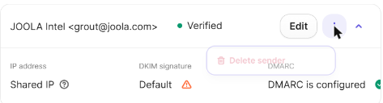
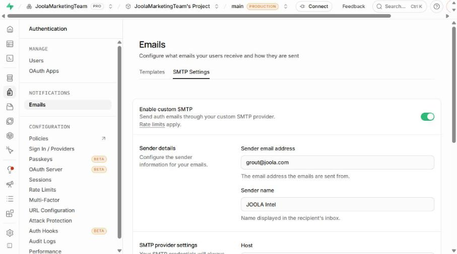
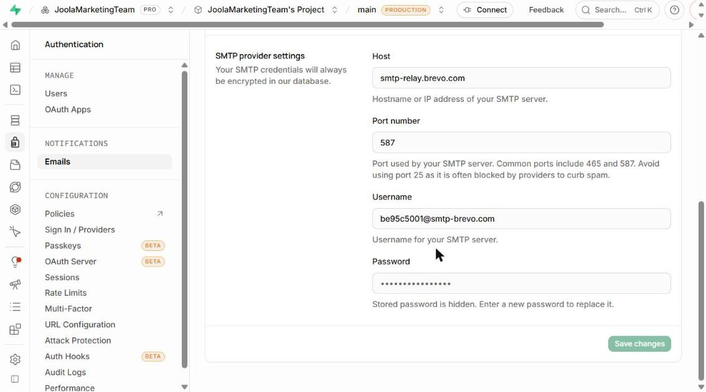
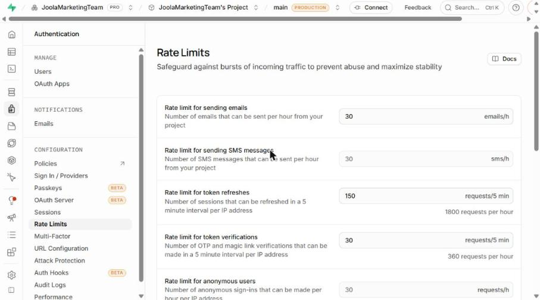
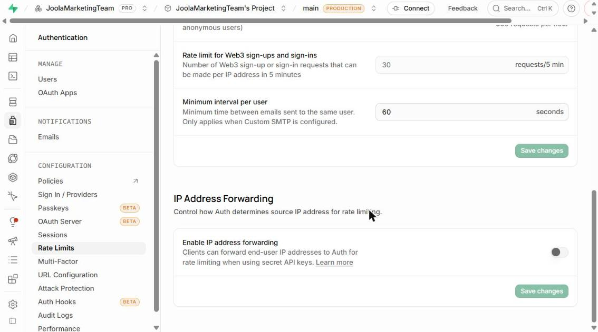

# JOOLA Intel — Login Email Setup (Brevo SMTP + Supabase)

**Set up on:** 17 October 2026
**Purpose:** Supabase sends its login emails (OTP code, magic link, confirmations) through
Brevo's free SMTP relay, using the sender name "JOOLA Intel".

> **Security:** this document has no SMTP key. The key is stored only inside Supabase,
> where it's encrypted and can't be read back. If it's lost or leaked, generate a new one
> (see §5A).

---

## 1. Summary of the setup

| Item | Value |
|---|---|
| Email provider | Brevo (app.brevo.com), account/organisation "Joola" |
| Sender name | JOOLA Intel |
| Sender email | grout@joola.com (status: Verified) |
| SMTP server | smtp-relay.brevo.com |
| SMTP port | 587 (STARTTLS) |
| SMTP login (username) | be95c5001@smtp-brevo.com |
| SMTP key in Brevo | one active key, regenerated 17 Oct 2026 after the first one failed (see §3.4); check the name in Brevo → SMTP keys |
| Supabase organisation | JoolaMarketingTeam (Pro plan) |
| Supabase project | JoolaMarketingTeam's Project, branch main (PRODUCTION) |
| Supabase project ref | loecyghnkkxyymelgexz |
| Email rate limit (Supabase) | 30 emails per hour |
| Minimum interval per user (Supabase) | 60 seconds |

---

## 2. What was done in Brevo

### 2.1 Account
- We used the existing Brevo account (organisation "Joola"). It was already logged in, so no
  new account was created.
- To check the plan and daily sending allowance, go to **Usage and plan** (top bar). The free
  plan allows about 300 emails per day; confirm the current figure there.

### 2.2 Sender added and verified
**Path:** Settings (gear icon) → Senders, domains, IPs → Senders tab → Add sender
**Direct link:** https://app.brevo.com/senders/list

1. Clicked **Add sender**.
2. From Name: `JOOLA Intel`; From Email: `grout@joola.com`. Clicked **Add sender**.
3. A pop-up asked "Authenticate your domain now?". We clicked **Do it later** (see §2.4).
4. Brevo emailed a 6-digit code to grout@joola.com. The code was entered and the sender now
   shows **Verified**.

Senders in the account now:
- Joola `<api@joola.com>`: Verified (already existed)
- JOOLA Intel `<grout@joola.com>`: Verified (new)

### 2.3 SMTP details and key
**Path:** Profile/Settings → SMTP & API → SMTP tab
**Direct link:** https://app.brevo.com/settings/keys/smtp

- SMTP Server: `smtp-relay.brevo.com`
- Port: `587`
- Login: `be95c5001@smtp-brevo.com`. This isn't secret; it's the same for all keys in this
  account.
- Clicked **Generate SMTP key**. Brevo first asked for a security code sent to the account
  owner's email (shown masked). After that step, a key named `supabase-joola-intel` was
  generated, copied and pasted straight into Supabase.
- Brevo shows a key only once. If it isn't copied straight away, generate a new one.

### 2.4 Left unchanged in Brevo (possible future improvements)
- **Domain authentication for joola.com was not done.** The sender list shows DKIM
  signature = "Default" with a warning; DMARC is configured. Authenticating the domain
  (adding Brevo's DKIM/SPF DNS records for joola.com) improves deliverability and keeps
  emails out of spam. It needs access to joola.com's DNS, usually through IT. See §5E.
- **"Block unauthorized IP addresses for SMTP keys" must stay OFF.** It was found ON during
  troubleshooting (§3.4) and switched off. Don't enable it
  unless Supabase's sending IPs are added under Security → Authorized IPs, or Supabase
  emails will stop.

---

## 3. What was done in Supabase

### 3.1 Custom SMTP
**Path:** Project → Authentication → Emails (under NOTIFICATIONS) → SMTP Settings tab
**Direct link:** https://supabase.com/dashboard/project/loecyghnkkxyymelgexz/auth/smtp

| Field | Value entered |
|---|---|
| Enable custom SMTP | ON |
| Sender email address | grout@joola.com |
| Sender name | JOOLA Intel |
| Host | smtp-relay.brevo.com |
| Port number | 587 (the default shown was 465 and was changed) |
| Username | be95c5001@smtp-brevo.com |
| Password | the Brevo SMTP key `supabase-joola-intel` (now shows as dots, "Stored password is hidden") |

Then clicked **Save changes**. Reloading the page confirmed all values were kept.

The current Supabase screen has no "Minimum interval" field on the SMTP page. That setting is
now on the Rate Limits page (§3.2).

### 3.2 Rate limits
**Path:** Authentication → Rate Limits (under CONFIGURATION)
**Direct link:** https://supabase.com/dashboard/project/loecyghnkkxyymelgexz/auth/rate-limits

When custom SMTP is turned on, Supabase automatically raises the email limit to 30 per hour,
so no manual save was needed. Values when checked:

| Setting | Value |
|---|---|
| Rate limit for sending emails | 30 emails/h (target) |
| Rate limit for sending SMS messages | 30 sms/h (unchanged) |
| Rate limit for token refreshes | 150 requests/5 min (unchanged) |
| Rate limit for token verifications | 30 requests/5 min (unchanged) |
| Rate limit for anonymous users | 30 requests/h (unchanged) |
| Rate limit for sign-ups and sign-ins | 30 requests/5 min (unchanged) |
| Rate limit for Web3 sign-ups and sign-ins | 30 requests/5 min (unchanged) |
| Minimum interval per user | 60 seconds (target) |
| IP address forwarding | OFF (unchanged) |

### 3.3 OTP login setup (done 17 Oct 2026)
All six steps were done and checked after a page reload. No step returned an error.

#### Step 1: Email provider and OTP settings
**Path:** Authentication → Sign In / Providers
**Direct link:** https://supabase.com/dashboard/project/loecyghnkkxyymelgexz/auth/providers

| Setting | Before | Now |
|---|---|---|
| Email provider: Enable | ON | ON (unchanged) |
| Confirm email | ON | **OFF** |
| Email OTP expiration | 3600 s | **600 s** (10 minutes) |
| Email OTP length | 8 | **6** |

"Confirm email" is not inside the Email provider panel. It's in the **User Signups** section
at the top of the Sign In / Providers page. It has to be OFF: when it's ON, a first-time user
gets the "Confirm signup" email (a link) instead of the Magic Link email with the code.

#### Step 2: Magic Link email template (the email that carries the code)
**Path:** Authentication → Emails → Templates → **Magic Link**
**Direct link:** https://supabase.com/dashboard/project/loecyghnkkxyymelgexz/auth/templates

Subject:
```
Your JOOLA Intel sign-in code
```
Body (HTML):
```html
<h2>JOOLA Intel sign-in</h2>
<p>Your sign-in code is:</p>
<p style="font-size:28px;font-weight:bold;letter-spacing:6px">{{ .Token }}</p>
<p>It expires in 10 minutes and can be used once.</p>
<p>If you didn't try to sign in, you can ignore this email.</p>
```
Rules: the body must contain `{{ .Token }}` (the 6-digit code) and must **not** contain
`{{ .ConfirmationURL }}`. The app asks for the code; it doesn't use links.

#### Step 3: URL configuration
**Path:** Authentication → URL Configuration
**Direct link:** https://supabase.com/dashboard/project/loecyghnkkxyymelgexz/auth/url-configuration

| Setting | Before | Now |
|---|---|---|
| Site URL | `http://localhost:3000` | `https://saas-joola-intel.vercel.app` |
| Redirect URLs | (empty) | `http://localhost:3000/**`, `https://saas-joola-intel.vercel.app/**` |

#### Step 4: Domain-only function (SQL)
**Path:** SQL Editor → run the contents of
[`migrations/029_auth_domain_hook.sql`](../migrations/029_auth_domain_hook.sql).
It creates `public.hook_joola_domain_only(event jsonb)`. The function refuses to create any
account whose email isn't `@joola.com` or `@joola.in`, even when someone calls Supabase
directly with the public key. Result: "Success. No rows returned".

Checks run, with the exact results:
```sql
select public.hook_joola_domain_only('{"user":{"email":"x@gmail.com"}}');
-- {"error":{"message":"Only JOOLA email addresses can sign in.","http_code":403}}
select public.hook_joola_domain_only('{"user":{"email":"A@JOOLA.in"}}');
-- {}
```
To undo: run [`migrations/029_rollback.sql`](../migrations/029_rollback.sql), but **remove the
hook first (Step 6)** or every sign-up will fail.

#### Step 5: Latest-data-date function (SQL)
**Path:** SQL Editor → run the contents of
[`migrations/030_dashboard_rpcs_base.sql`](../migrations/030_dashboard_rpcs_base.sql).
It creates `public.rpc_latest_data_date()`. The date picker uses it to anchor its default range
on the newest data instead of today. Result: "Success. No rows returned".
```sql
select public.rpc_latest_data_date();
-- 2026-10-12
```
To undo: [`migrations/030_rollback.sql`](../migrations/030_rollback.sql).

Steps 4 and 5 ran in one unsaved scratch query, not saved snippets. The repo files are the
source of truth.

#### Step 6: Register the hook
**Path:** Authentication → Hooks → Add hook → **Before User Created**
**Direct link:** https://supabase.com/dashboard/project/loecyghnkkxyymelgexz/auth/hooks

| Field | Value |
|---|---|
| Hook type | Postgres |
| Schema | public |
| Function | `hook_joola_domain_only` |
| Status | Enabled |

When the hook is created, Supabase offers to run some grant statements. They're the same
grants as in the Step 4 SQL, so nothing new was granted.

#### How the pieces fit together
1. A user enters their email on `/login`. The app rejects non-JOOLA domains immediately
   (`frontend/lib/auth/rules.ts`).
2. The app calls Supabase `signInWithOtp`. For a new address, the **Before User Created hook**
   checks the domain again.
3. Supabase emails the **Magic Link template** (Step 2) through **Brevo SMTP** (§3.1). The
   email holds a 6-digit code valid for 10 minutes (Step 1), limited to 30 emails/h and one
   per user every 60 s (§3.2).
4. The user enters the code. The app calls `verifyOtp` and the user is signed in for
   **7 days**, which the app checks in `frontend/middleware.ts` using `last_sign_in_at`.

#### If you ever change the allowed domains
Change both places, or they will disagree:
- `frontend/lib/auth/rules.ts` → `ALLOWED_DOMAINS`
- The regex in `migrations/029_auth_domain_hook.sql` (re-run it in the SQL Editor)

`backend/tests/test_auth_hook_regex.py` fails if the two drift apart.

### 3.4 Troubleshooting log: first sign-in failed (17 Oct 2026)
**Symptom:** the login page showed "Could not send the code. Try again shortly." The local
server log said `signInWithOtp failed: 500 Error sending magic link email`.

**Diagnosis:**
- Supabase → Logs → Auth showed `535 "5.7.8 Authentication failed"` on `/otp`. Brevo
  rejected the SMTP username and key pair.
- Brevo → Transactional → Logs showed **zero events**, so Brevo never accepted an email.
- The key saved in Supabase no longer existed in Brevo. The only key left had never been
  used.
- Brevo → Security → Authorized IPs → **SMTP IP blocking was ON** with 0 authorized IPs. That
  blocks Supabase, whose sending IPs aren't fixed.

**Fix:**
1. Brevo → Security → Authorized IPs → SMTP keys → **Deactivate**.
2. Brevo → SMTP & API → SMTP → **Generate a new SMTP key**. The full key is long and starts
   with `xsmtpsib-`.
3. Supabase → SMTP Settings → paste the key into Password → Save.
4. Deleted the old and unused keys in Brevo.

**Result:** codes are sent and arrive, but take **2–3 minutes** because joola.com isn't
domain-authenticated in Brevo (§2.4, §5E). The login page now says the email can take 2–3
minutes, and Resend unlocks after 3 minutes (each new code replaces the previous one).

**Never paste an SMTP key into a chat or a document.** If one is pasted anywhere, rotate it
(§5A).

### 3.5 Automated QA account
- `qa-bot@joola.in` exists in Supabase Auth so the regression suite can run behind the login.
- `frontend/qa/qa-session.mjs` signs it in with the service-role key from the local `.env`.
  `generateLink` returns the code instead of emailing it, so **no email is sent** and the
  Brevo quota is untouched.
- The session is saved to `frontend/qa/.auth/state.json`, which is gitignored.
- The service-role key is used only locally. It must never be added to Vercel.

---

## 4. How to test
1. On the login page, enter a `@joola.com` or `@joola.in` address and request a code.
2. The email should arrive from **JOOLA Intel `<grout@joola.com>`**. Check spam too.
3. If it doesn't arrive:
   - **Supabase:** Logs → Auth logs. Look for SMTP errors such as authentication failed or
     connection refused.
   - **Brevo:** Transactional → Logs (or Statistics). Check whether the email was accepted,
     delivered, bounced or blocked.

---

## 5. Common tasks

### A. Replace or rotate the SMTP key (if leaked, lost, or Supabase shows "auth failed")
1. Brevo → SMTP & API → SMTP → **Generate SMTP key** → enter the security code emailed to the
   account owner → name it (e.g. `supabase-joola-intel-2027`) → copy the key.
2. Supabase → Authentication → Emails → SMTP Settings → click **Password** → paste the new key
   → **Save changes**.
3. Send a test email (§4).
4. Back in Brevo, deactivate or delete the old key in the "Your SMTP Keys" list.

### B. Change the sender email address
1. Brevo → Senders → **Add sender** with the new address → verify with the emailed code.
2. Supabase → SMTP Settings → change **Sender email address** → Save. The sender must be
   verified in Brevo first, or Brevo will reject the emails.

### C. Change the email rate limit or interval
Supabase → Authentication → Rate Limits → edit "Rate limit for sending emails" and/or
"Minimum interval per user" → Save changes. Keep the hourly limit within Brevo's daily
allowance.

### D. Turn off custom SMTP (fall back to Supabase's built-in email)
Supabase → SMTP Settings → switch **Enable custom SMTP** off → Save. Supabase's built-in email
has a very low limit and is meant only for testing.

### E. Authenticate joola.com in Brevo (recommended)
Brevo → Senders, domains, IPs → **Domains** tab → Add/authenticate `joola.com` → add the DNS
records Brevo shows (DKIM, Brevo code, DMARC/SPF) at the joola.com DNS provider → click
**Verify** in Brevo.

---

## 6. Reusable prompt (paste into Claude in future)

```
I use Brevo (free SMTP) to send Supabase auth emails for "JOOLA Intel".
Current setup:
- Brevo sender: JOOLA Intel <grout@joola.com> (verified)
- Brevo SMTP: smtp-relay.brevo.com, port 587, login be95c5001@smtp-brevo.com,
  one SMTP key (stored only in Supabase); SMTP IP blocking OFF
- Supabase project ref: loecyghnkkxyymelgexz (JoolaMarketingTeam's Project, main/PRODUCTION)
  Authentication → Emails → SMTP Settings: custom SMTP ON with the values above
  Authentication → Rate Limits: emails 30/h, minimum interval per user 60 s
Security rules: never type, print or repeat any SMTP key; I will paste keys
myself; stop and ask if any page needs payment, phone, CAPTCHA or a security code.
Task: <describe what you want changed, e.g. rotate the SMTP key / change sender / raise limit>
```

---

## 7. Screenshots (17 Oct 2026)

Brevo sender verified (DKIM "Default" warning, see §2.4):



Supabase → Emails → SMTP Settings: custom SMTP on, sender details:



Supabase → Emails → SMTP Settings: host, port 587, username, password hidden:



Supabase → Rate Limits: 30 emails/h, 30 token verifications per 5 min:



Supabase → Rate Limits: minimum interval per user 60 s, IP forwarding off:



---

## Related files
- Design and decisions: [superpowers/specs/2026-10-17-auth-datefilter-performance-design.md](superpowers/specs/2026-10-17-auth-datefilter-performance-design.md)
- Domain hook SQL: [../migrations/029_auth_domain_hook.sql](../migrations/029_auth_domain_hook.sql)
- Data-date RPC SQL: [../migrations/030_dashboard_rpcs_base.sql](../migrations/030_dashboard_rpcs_base.sql)
